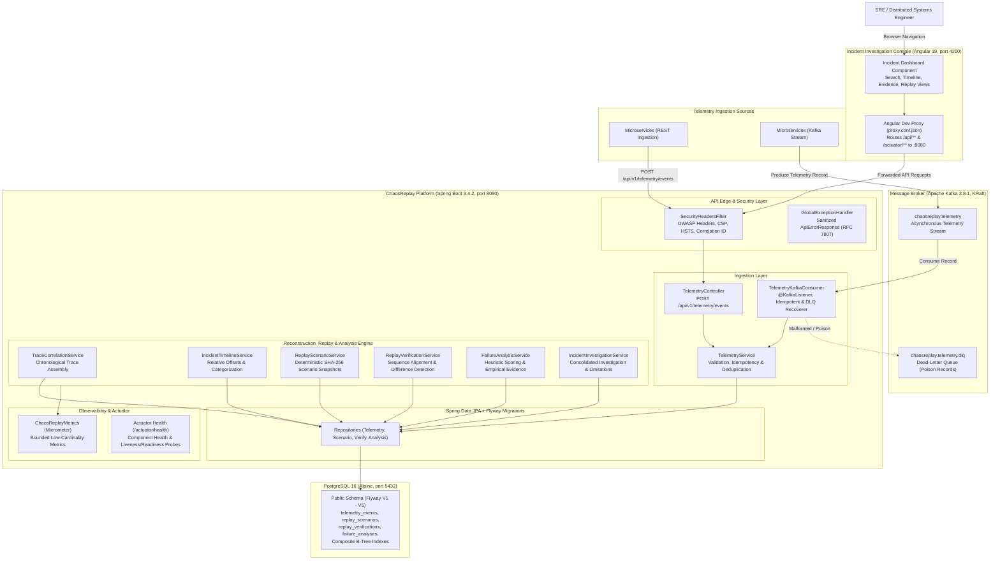
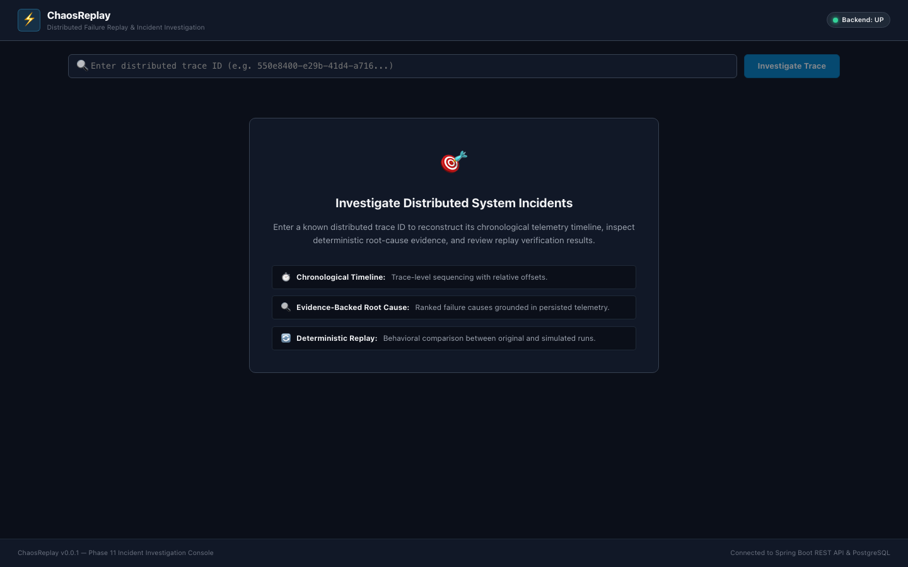
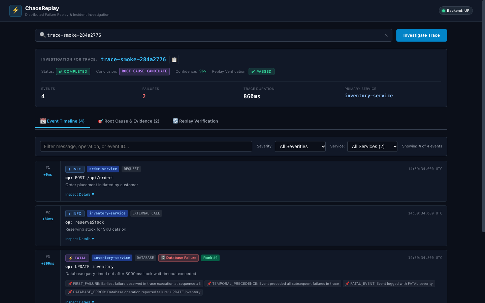
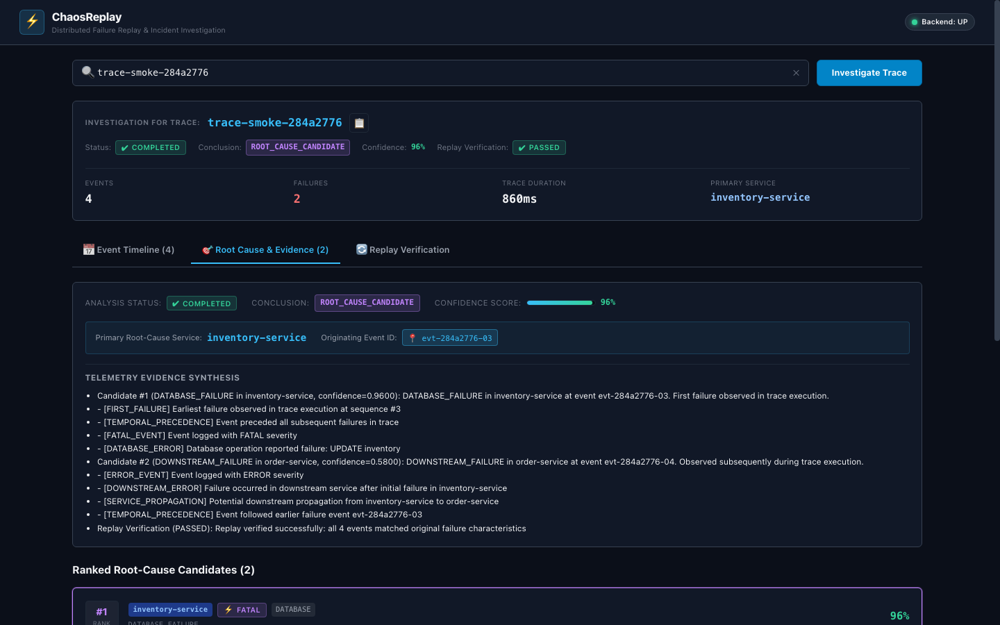
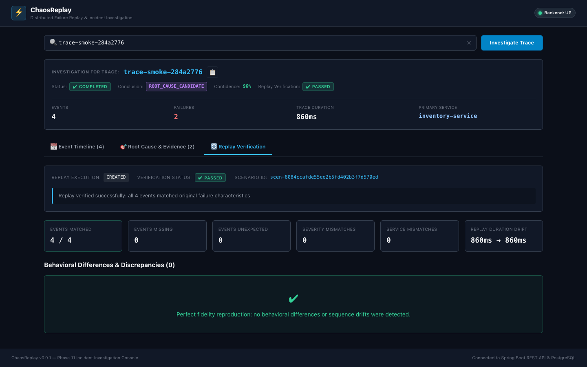

# ChaosReplay

**Distributed Failure Reconstruction, Deterministic Replay & Incident Investigation Platform**

[](#automated-test-suite)
[](https://openjdk.org/)
[](https://spring.io/projects/spring-boot)
[](https://angular.dev/)
[](https://www.postgresql.org/)
[](https://kafka.apache.org/)

---

## Overview

ChaosReplay is a distributed failure reconstruction, deterministic replay, and incident investigation platform designed to solve one of distributed systems engineering's most challenging problems: **reproducing, isolating, and explaining complex multi-service production failures.**

In modern microservice architectures, transient outages, concurrency race conditions, cascading socket exhaustions, and partial network partitions rarely replicate cleanly in staging environments. Logs are scattered across services, timestamps drift across nodes, and developers lack deterministic environments to verify whether a proposed fix truly resolves a failure mode without introducing subtle regressions.

ChaosReplay addresses this by providing:
1. **Dual Ingestion**: High-throughput REST and asynchronous Apache Kafka event ingestion with database-level idempotency and dead-letter queue (DLQ) poison-record isolation.
2. **Deterministic Timelines**: Chronological reconstruction of distributed traces (`timestamp ASC, eventId ASC`) with millisecond offsets from the initial event (`+0ms`) and semantic failure classifications.
3. **Deterministic Replay & Verification**: Cryptographic scenario snapshots (SHA-256), simulated fault execution, and sequence-alignment verification to detect behavioral discrepancies.
4. **Explainable Root-Cause Analysis**: Evidence-backed heuristic ranking with verifiable confidence scores (`0.0 - 1.0`), strict non-hallucination guarantees, and empirical trace citations.
5. **Developer Console**: An Angular 19 incident investigation dashboard with dark developer aesthetics, live backend health monitoring, multi-axis timeline filtering, and interactive evidence navigation.

---

## Architecture



---

## Core Engineering Capabilities

### 1. Dual Telemetry Ingestion (REST & Event-Driven Kafka)
- **Synchronous REST**: `POST /api/v1/telemetry/events` with strict Jakarta Bean Validation, UUID format enforcement, and immediate duplicate rejection (`409 Conflict`).
- **Asynchronous Kafka**: Real-time consumer (`chaosreplay-telemetry-group`) reading from `chaosreplay.telemetry`.
- **Database-Level Idempotency**: At-least-once Kafka deliveries with identical `eventId` are caught by `DuplicateEventException`, logged as structured warnings, and committed cleanly as safe no-ops without DLQ pollution.
- **Poison-Pill Isolation (DLQ)**: Malformed JSON, unparseable enums, or schema violations route immediately to `chaosreplay.telemetry.dlq` via `DeadLetterPublishingRecoverer` with full diagnostic headers (`kafka_dlt-*`).
- **Bounded Retries**: Transient infrastructure exceptions (e.g., database connection timeouts) retry up to 3 times with fixed backoff before falling back to the DLQ.

### 2. Deterministic Incident Timelines
- **Strict Chronological Sequencing**: Events are ordered deterministically by `timestamp ASC, eventId ASC`.
- **Normalized Relative Offsets**: The initial event in any trace is anchored at `0 ms`, and subsequent events compute relative millisecond deltas (`offsetMs`), insulating engineers from inter-server clock skew.
- **Categorization Taxonomy**: Events are classified into explicit operational categories:
  - `DATABASE_FAILURE`, `EXTERNAL_CALL_FAILURE`, `TIMEOUT_SIGNAL`
  - `DOWNSTREAM_ERROR`, `FATAL_EVENT`, `ERROR_EVENT`
  - `REPLAY_DIVERGENCE`, `NORMAL_EVENT`
- **Propagation Grounding**: Downstream cascading errors (`failurePropagation: true`) are flagged only when backed by concrete temporal and service-dependency evidence.

### 3. Deterministic Failure Replay & Scenario Snapshots
- **Cryptographic Scenario Identity**: Replay scenarios generate deterministic SHA-256 scenario IDs based on canonical trace events and parameters (`scen-<32-char-hex>`).
- **Idempotent Scenario Generation**: Generating a scenario multiple times returns `200 OK` with the existing immutable snapshot.
- **Simulated Execution**: Safe in-memory simulation engine records simulated execution events and timestamps without polluting production infrastructure.

### 4. Sequence-Alignment Replay Verification
- **Automated Verdicts**: Classifies replay fidelity into `PASSED`, `PARTIAL`, or `FAILED`.
- **Granular Difference Detection**: Line-item tracking for:
  - Missing events (expected in snapshot, omitted in replay)
  - Unexpected events (surfaced during replay, not in snapshot)
  - Severity and service mismatches
  - Latency and duration drift anomalies

### 5. Explainable, Evidence-Backed Root-Cause Analysis
- **Zero Hallucination Guarantee**: ChaosReplay **never guesses, speculates, or hallucinates** root causes using LLMs. Every conclusion is strictly traceable to persisted telemetry, replay snapshots, and verification differences.
- **Multi-Factor Heuristic Scoring**:
  - Base confidence by candidate failure category: `DATABASE_FAILURE` (0.85), `EXTERNAL_DEPENDENCY_FAILURE` (0.85), `TIMEOUT` (0.80), `APPLICATION_ERROR` (0.70), `SERVICE_FAILURE` (0.65).
  - Bounded empirical bonuses: `FIRST_FAILURE` (+0.05), `TEMPORAL_PRECEDENCE` (+0.03), `REPLAY_MISMATCH` (+0.05).
- **Deterministic Ranking**: Candidates are ranked by Confidence (`DESC`), First Timestamp (`ASC`), Sequence (`ASC`), Event ID (`ASC`), and Service (`ASC`).
- **Insufficient Evidence Honesty**: If a trace exhibits no failures or insufficient data, the engine returns `status: INSUFFICIENT_EVIDENCE` and `conclusion: NO_FAILURE_OBSERVED` with confidence `0.0`.

### 6. Angular 19 Developer Dashboard
- **Reactive Search & Cancellation**: Real-time trace search with RxJS `switchMap` automatically cancels in-flight HTTP requests when a new search query is submitted.
- **Live Health Monitoring**: Visual connectivity badge queries `/api/v1/health` on load, reporting `UP` or `DOWN` without polling loops.
- **Chronological Timeline View**: Sequence indexing (`#1, #2...`), relative millisecond offsets, multi-axis filtering (severity, service, query), and expandable JSON payload inspectors.
- **Evidence Panel**: Hypothesis summary card, confidence score gauge, ranked failure candidates, and **`Jump to Event in Timeline`** navigation.
- **Replay Verification View**: Comparative drift metrics grid and detailed behavioral discrepancy table.
- **Accessibility & Contrast**: Built with dark developer ergonomics (`#0b1120`, `#111827`, `#1f2937`), high contrast ratios, and accessible status badges combining textual glyphs (`✖`, `⚡`, `▲`, `✔`, `ℹ`) with color coding.

### 7. API Security Hardening & Reliability
- **Strict Boundary Validation**: Jakarta Bean Validation enforces character sets (`^[a-zA-Z0-9-_.:]+$`), maximum lengths, and collection limits on all endpoints.
- **Sanitized Error Responses**: Standardized RFC 7807 `ApiErrorResponse` strips all internal Java package names, class hierarchies, and database error traces from public responses.
- **OWASP Security Headers**: `X-Content-Type-Options: nosniff`, `X-Frame-Options: DENY`, `Referrer-Policy: strict-origin-when-cross-origin`, strict `Content-Security-Policy`, and `Permissions-Policy`.
- **Conditional HSTS**: `Strict-Transport-Security` is emitted strictly over HTTPS or behind trusted reverse proxies forwarding `X-Forwarded-Proto: https` (RFC 6797).
- **Configurable CORS**: Disabled by default (`403 Forbidden` for cross-origin browser requests; same-origin allowed). When enabled, operators configure explicit allowed origins. Wildcard origins with credentials are explicitly prohibited.

### 8. Performance & Observability
- **Composite B-Tree Indexes (Flyway V5 Migration)**: Indexes on `(trace_id, timestamp ASC, event_id ASC)` and `(request_id, timestamp ASC, event_id ASC)` eliminate in-memory sorting on telemetry queries.
- **Low-Cardinality Metrics (Micrometer)**: Centralized metrics tracking ingestion rates, Kafka lag/DLQ counters, timeline query durations, scenario generations, and replay verifications.
- **Hardened Actuator Probes**: Exposes `health`, `info`, and `metrics` while disabling sensitive administrative endpoints (`env`, `heapdump`, etc.). Health details (`show-details: never`) conceal internal database URLs from unauthorized discovery.

---

## Technology Stack

| Layer | Component | Version / Library | Purpose |
| :--- | :--- | :--- | :--- |
| **Backend** | Language | Java 21 LTS | Core backend platform |
| | Framework | Spring Boot 3.4.2 | Application framework & dependency injection |
| | Persistence | Spring Data JPA / Hibernate 6.6 | ORM & data access |
| | Database Migration | Flyway 10.20 | Version-controlled database migrations (V1–V5) |
| | Messaging | Spring Kafka / Apache Kafka 3.8.1 | Asynchronous telemetry streaming & DLQ handling |
| | Metrics & Health | Spring Boot Actuator & Micrometer | Production telemetry, liveness/readiness probes |
| | Security & Validation | Jakarta Bean Validation, Servlet Filters | Input sanitization, OWASP headers, CORS |
| | Testing | JUnit 5, Mockito, Testcontainers | Unit, WebMvc slice, and PostgreSQL/Kafka tests |
| **Frontend** | Framework | Angular 19.2 (Standalone) | Reactive developer investigation console |
| | Language | TypeScript 5.7 | Strongly-typed models matching backend DTOs |
| | Styling | Tailwind CSS | Dark developer aesthetic, responsive layouts |
| | Streaming | RxJS 7.8 | Cancellation-aware search & error resilience |
| | Testing | Jasmine 5.6 & Karma 6.4 | Headless component & service unit testing |
| **Infrastructure** | Database | PostgreSQL 16 (Alpine) | Primary relational store for telemetry & analysis |
| | Message Broker | Apache Kafka 3.8.1 (KRaft mode) | Telemetry ingestion event stream |
| | Containerization | Docker & Docker Compose | Multi-container local orchestration |

---

## Repository Structure

```
chaos-replay/
├── .env.example                     # Environment template for local configuration
├── Dockerfile                       # Multi-stage production container build for backend
├── docker-compose.yml               # PostgreSQL 16 & Apache Kafka 3.8.1 infrastructure
├── pom.xml                          # Maven build definition & dependencies
├── README.md                        # Project documentation & architectural guide
├── scripts/
│   ├── smoke_test.py                # Automated end-to-end smoke test workflow
│   └── smoke_test.sh                # Executable wrapper script for smoke test
├── frontend/                        # Angular 19 incident investigation dashboard
│   ├── angular.json                 # Angular build & proxy configuration
│   ├── package.json                 # Frontend dependencies & npm scripts
│   ├── proxy.conf.json              # Dev reverse proxy routing /api & /actuator to :8080
│   └── src/
│       ├── app/
│       │   ├── core/models/         # Strongly-typed domain contracts & DTOs
│       │   ├── core/services/       # Incident API service with RxJS error translation
│       │   ├── features/incidents/  # Incident dashboard container & search stream
│       │   ├── features/timeline/   # Chronological timeline & filter controls
│       │   ├── features/evidence/   # Ranked root-cause candidates & evidence jumper
│       │   ├── features/replay/     # Replay verification metrics & discrepancy table
│       │   └── shared/              # Status badges, skeletons, and error alerts
│       └── styles.css               # Global dark developer typography & utility styles
└── src/
    ├── main/
    │   ├── java/com/chaosreplay/
    │   │   ├── api/                 # REST controllers (Telemetry, Timeline, Replay, etc.)
    │   │   ├── api/dto/             # Request & response data transfer objects
    │   │   ├── domain/              # Entities (TelemetryEvent, ReplayScenario, Analysis, etc.)
    │   │   ├── repository/          # Spring Data JPA repositories
    │   │   ├── service/             # Domain logic (Timeline, Replay, Analysis, Kafka)
    │   │   ├── security/            # Security headers filter, CORS, and exception handling
    │   │   └── metrics/             # Centralized Micrometer observability metrics
    │   └── resources/
    │       ├── application.yml      # Base configuration & actuator settings
    │       ├── application-local.yml# Local development profiles & datasource configuration
    │       └── db/migration/        # Flyway SQL migrations (V1 through V5)
    └── test/                        # 223 automated unit, slice, and integration tests
```

---

## Local Development & Setup

### Prerequisites

| Tool | Version Requirement | Verification Command |
| :--- | :--- | :--- |
| **Java** | OpenJDK 21 LTS | `java -version` |
| **Maven** | Handled via included `./mvnw` | `./mvnw -version` |
| **Node.js** | Node.js `20.x` or later | `node -v` |
| **npm** | npm `10.x` or later | `npm -v` |
| **Docker** | Docker Engine 24+ & Compose v2 | `docker compose version` |

---

### Step 1: Start Infrastructure (PostgreSQL & Kafka)

Launch PostgreSQL 16 and Apache Kafka 3.8.1 (running in KRaft mode, no Zookeeper required):

```bash
docker compose up -d
```

Verify that both containers report `(healthy)`:
```bash
docker compose ps
```

*Expected output:*
```text
NAME                   IMAGE                STATUS
chaosreplay-kafka      apache/kafka:3.8.1   Up (healthy)
chaosreplay-postgres   postgres:16-alpine   Up (healthy)
```

---

### Step 2: Start Spring Boot Backend

Run the backend application using the bundled Maven Wrapper:

```bash
./mvnw spring-boot:run
```

The application will automatically run Flyway migrations (`V1` to `V5`), subscribe to the Kafka topic `chaosreplay.telemetry`, and bind to port `8080`.

Verify backend health:
```bash
curl -s http://localhost:8080/actuator/health
```

*Expected response:*
```json
{"status":"UP","groups":["liveness","readiness"],"components":{"db":{"status":"UP"},"diskSpace":{"status":"UP"},"livenessState":{"status":"UP"},"ping":{"status":"UP"},"readinessState":{"status":"UP"},"ssl":{"status":"UP"}}}
```

---

### Step 3: Start Angular Developer Console

In a separate terminal, start the Angular development server:

```bash
cd frontend
npm install
npm start
```

The frontend will start at **`http://localhost:4200`**.
The development proxy (`proxy.conf.json`) automatically routes `/api/*` and `/actuator/*` calls directly to `http://localhost:8080` without requiring permissive CORS headers on the backend.

---

### Step 4: Stop All Services

When finished testing, shut down the services:

1. Stop the Angular server: Press `Ctrl+C` in the frontend terminal.
2. Stop the Spring Boot application: Press `Ctrl+C` in the backend terminal.
3. Tear down the Docker containers and networks:
   ```bash
   docker compose down
   ```

---

## End-to-End Smoke Test

ChaosReplay includes an automated end-to-end smoke test script (`scripts/smoke_test.py`) that executes the entire distributed failure replay lifecycle against the running backend and frontend proxy.

### What the Smoke Test Validates:
1. **Health Verification**: Asserts Spring Boot Actuator and database connectivity are `UP`.
2. **Telemetry Ingestion**: Generates a uniquely identified incident trace (`trace-smoke-<uuid>`) across multiple microservices (`order-service`, `inventory-service`) and ingests events via `POST /api/v1/telemetry/events`.
3. **Incident Timeline**: Reads `GET /api/v1/incidents/traces/{traceId}/timeline` and asserts strict ascending offset ordering (`+0ms`, `+80ms`, `+800ms`), failure counts, and category tags.
4. **Replay Scenario**: Generates a deterministic replay scenario via `POST /api/v1/replay/scenarios/traces/{traceId}` and extracts the returned `scenarioId`.
5. **Replay Verification**: Executes verification via `POST /api/v1/replay/scenarios/{scenarioId}/verify`, asserting a `PASSED` verdict and zero behavioral drift.
6. **Failure Analysis**: Triggers deterministic root-cause analysis via `POST /api/v1/analysis/traces/{traceId}`, validating heuristic confidence scoring and empirical evidence citations.
7. **Consolidated Investigation**: Queries `GET /api/v1/incidents/traces/{traceId}` to verify that timeline, scenario, verification, and analysis states are fully aggregated.
8. **Frontend Proxy**: Validates that the Angular development server (`http://localhost:4200`) is serving and proxying requests cleanly.

### Running the Smoke Test:

With the backend and frontend running:

```bash
python3 scripts/smoke_test.py
```
*or via the executable wrapper:*
```bash
./scripts/smoke_test.sh
```

**Options:**
- `--backend-url <url>`: Override backend base URL (default: `http://localhost:8080`).
- `--frontend-url <url>`: Override frontend base URL (default: `http://localhost:4200`).
- `--skip-frontend`: Run only against the backend API without checking the frontend dev server.

---

## Interactive UI Demonstration Workflow

To demonstrate ChaosReplay during technical interviews or portfolio walkthroughs:

1. **Start Services**:
   ```bash
   docker compose up -d
   ./mvnw spring-boot:run           # (Terminal 1)
   cd frontend && npm start         # (Terminal 2)
   ```
2. **Generate Demonstration Data**:
   Run the smoke test to inject fresh, realistic multi-service telemetry:
   ```bash
   python3 scripts/smoke_test.py
   ```
   Note the generated Trace ID printed in the console output (e.g. `trace-smoke-a1b2c3d4`).

3. **Explore the Investigation Dashboard**:
   Open **`http://localhost:4200`** in your browser:
   * **Connection Status**: Observe the top-right status pill: `● Backend: UP (Spring Boot :8080)`.
   * **Search**: Enter the generated Trace ID (e.g. `trace-smoke-a1b2c3d4`) and click **Investigate**.
   * **Event Timeline Tab**:
     * Inspect the relative timing column (`+0ms`, `+80ms`, `+800ms`).
     * Filter by severity (`Error & Fatal`) or type in the search box to find specific operations.
     * Click **View Payload** on any event to inspect raw JSON metadata.
   * **Root Cause & Evidence Tab**:
     * Review the hypothesis card and confidence gauge (`0% - 100%`).
     * Inspect the ranked candidate causes and supporting empirical evidence items.
     * Click **Jump to Event in Timeline** to automatically switch tabs, highlight the target event row, and scroll it into view.
   * **Replay Verification Tab**:
     * Confirm the execution status and verification verdict (**`PASSED`**).
     * Review the comparative drift metrics grid (Matched Events, Missing Events, Duration Drift).
### Dashboard Screenshots

| View | Screenshot |
| :--- | :--- |
| **Initial State & Health Probe** |  |
| **Chronological Incident Timeline** |  |
| **Evidence-Backed Root Cause Panel** |  |
| **Deterministic Replay Verification** |  |

---

## API Reference Matrix

All endpoints require valid input boundaries and return sanitized error responses adhering to RFC 7807.

| Category | HTTP Method | Endpoint Path | Description |
| :--- | :--- | :--- | :--- |
| **Health** | `GET` | `/api/v1/health` | Lightweight service connectivity check |
| | `GET` | `/actuator/health` | Component health, liveness, and readiness probes |
| | `GET` | `/actuator/metrics` | Bounded Micrometer operational telemetry |
| **Telemetry** | `POST` | `/api/v1/telemetry/events` | Ingest single telemetry event (synchronous REST) |
| | `GET` | `/api/v1/telemetry/events` | Paginated telemetry event query (`page`, `size`) |
| **Traces** | `GET` | `/api/v1/traces/{traceId}` | Correlated events for a distributed trace |
| | `GET` | `/api/v1/traces/{traceId}/reconstruction` | Chronologically reconstructed trace model |
| **Incidents** | `GET` | `/api/v1/incidents/traces/{traceId}/timeline` | Reconstructed incident timeline with relative offsets |
| | `GET` | `/api/v1/incidents/traces/{traceId}` | Consolidated incident investigation view |
| **Replay** | `POST` | `/api/v1/replay/scenarios/traces/{traceId}` | Create deterministic replay scenario from trace |
| | `GET` | `/api/v1/replay/scenarios/{scenarioId}` | Inspect scenario metadata and snapshot events |
| | `POST` | `/api/v1/replay/scenarios/{scenarioId}/execute` | Run simulated replay execution |
| **Verification** | `POST` | `/api/v1/replay/scenarios/{scenarioId}/verify` | Verify replay against original telemetry |
| | `GET` | `/api/v1/replay/verifications/{verificationId}` | Verification outcome, metrics, and discrepancies |
| **Analysis** | `POST` | `/api/v1/analysis/traces/{traceId}` | Execute deterministic root-cause failure analysis |
| | `GET` | `/api/v1/analysis/{analysisId}` | Retrieve failure analysis by ID |

---

## Security Boundaries & Production Hardening

- **Authentication & Authorization Scope**: ChaosReplay focuses on telemetry reconstruction, deterministic replay verification, and root-cause analysis. It does **not** currently implement internal user authentication (OAuth2/OIDC/JWT) or role-based access control. In production environments, ChaosReplay must be deployed inside a private network or VPC behind an authenticating API gateway (e.g. Envoy, Kong, AWS ALB).
- **CORS Protection**: Disabled by default (`chaosreplay.security.cors.enabled: false`). Cross-origin requests from browsers are rejected with `403 Forbidden`. When enabled via environment variables, allowed origins must be explicitly enumerated.
- **HSTS Enforcement**: `Strict-Transport-Security` is emitted only when requests arrive over HTTPS or through a trusted proxy sending `X-Forwarded-Proto: https`, avoiding issues when testing over local HTTP.
- **Actuator Hardening**: Administrative actuators (`env`, `heapdump`, `beans`, `configprops`) are explicitly disabled. Health endpoints suppress internal connection credentials (`show-details: never`).

---

## Automated Test Suite

ChaosReplay maintains comprehensive automated test suites across both the backend and frontend:

### Backend Tests (223 Tests):
```bash
./mvnw clean test
```
- **Unit Tests**: Mockito-based service and logic tests.
- **WebMvc Slice Tests**: Controller validation, security headers, correlation IDs, and error handling.
- **PostgreSQL Testcontainers**: Real PostgreSQL 16 container verifying Flyway migrations, database constraints, and composite B-tree index queries.
- **Kafka Testcontainers**: Real Kafka container verifying asynchronous message consumption, idempotency on duplicate keys, retry backoffs, and dead-letter queue routing.

### Frontend Tests (48 Tests):
```bash
cd frontend
npm test -- --watch=false --browsers=ChromeHeadless
```
- **Component Tests**: Timeline filtering, evidence jumper, replay verification diff table, and loading states.
- **Service Tests**: Typed HTTP requests, proxy handling, and RxJS stream error resilience.

### Frontend Production Build:
```bash
cd frontend
npm run build
```
Generates optimized, treeshaken production bundles in `frontend/dist/frontend`.

---

## Known Limitations & Roadmap

### Current Limitations:
- **Local Single-Broker Kafka**: The bundled `docker-compose.yml` provides a single-broker Kafka setup configured for local developer ergonomics rather than multi-AZ partition replication.
- **Simulation Engine**: Replay simulation executes in-memory. Full physical network fault injection and container isolation are planned for subsequent phases.
- **Immutable Telemetry**: Telemetry events, replay scenarios, and verifications are append-only and cannot be updated or deleted via API.

### Project Milestones & Roadmap:
- **Phase 1 — Foundation & Domain Architecture** *(Completed)*
- **Phase 2 — Telemetry Ingestion API** *(Completed)*
- **Phase 3 — Trace Correlation & Failure Reconstruction** *(Completed)*
- **Phase 4 — Deterministic Failure Replay & Scenario Generation** *(Completed)*
- **Phase 5 — Replay Verification & Difference Comparison** *(Completed)*
- **Phase 6 — Deterministic Root-Cause Failure Analysis** *(Completed)*
- **Phase 7 — Chronological Incident Timeline & Insights** *(Completed)*
- **Phase 8 — Event-Driven Telemetry Ingestion with Kafka** *(Completed)*
- **Phase 9 — Performance Metrics, Indexing & Observability** *(Completed)*
- **Phase 10 — API Security Hardening & Reliability** *(Completed)*
- **Phase 11 — Angular Incident Investigation Dashboard** *(Completed)*
- **Phase 12 — Portfolio Polish, E2E Verification & Deployment Readiness** *(Completed)*

### Future Exploration:
- **Service Dependency Graph**: Topology inference from distributed trace edges.
- **Minimal Reproduction Engine**: Pruning unrelated events to produce minimal failing test cases.
- **Isolated Replay Execution**: Replay execution within dedicated Docker/container sandboxes.
- **Chaos Fault Injection**: Controlled network latency, packet loss, and CPU throttling.