# ChaosReplay

## Overview

ChaosReplay is designed to become an end-to-end distributed failure reconstruction and fix-verification platform. Modern microservice and distributed systems suffer from rare, non-deterministic, and cascading failures that are notoriously difficult to capture, isolate, and debug.

ChaosReplay's long-term vision is to automatically ingest distributed runtime telemetry, correlate cross-service events into deterministic execution timelines, reconstruct production incidents into minimal reproducible failure scenarios, replay them inside isolated environments with deterministic fault injection, and verify candidate code fixes before production release.

> **Note**: ChaosReplay is being developed in deliberate engineering phases. The current codebase implements **Phase 1 — Foundation**, **Phase 2 — Telemetry Ingestion**, **Phase 3 — Telemetry Correlation & Failure Reconstruction**, **Phase 4 — Deterministic Failure Replay & Scenario Generation**, **Phase 5 — Replay Verification & Failure Comparison**, **Phase 6 — Deterministic Failure Analysis & Root-Cause Evidence**, **Phase 7 — Incident Timeline & Explainable Failure Insights**, **Phase 8 — Event-Driven Telemetry Ingestion with Kafka**, and **Phase 9 — Performance, Caching & Observability**. Future capabilities (service dependency graphs, minimal reproduction engine, chaos injection, incident graphs, UI dashboards) will be built incrementally in subsequent phases.

---

## Problem

Reproducing production bugs and catastrophic incidents in distributed systems is one of the hardest problems in software engineering:

1. **Non-Deterministic Concurrency**: Many failures occur only under specific race conditions, network latency spikes, or cross-service event orderings that cannot be reproduced on local developer machines.
2. **Cascading State Corruption**: A failure in an upstream dependency often propagates silently through messaging queues and caches, surfacing symptoms in completely unrelated downstream services.
3. **Environment Parity Gaps**: Staging environments rarely replicate the traffic volume, data topology, or network dynamics required to trigger transient edge-case failures.
4. **Verification Uncertainty**: Developers attempting to fix complex distributed bugs lack a reliable method to prove that a candidate patch genuinely solves the failure mode without introducing subtle regressions under identical fault conditions.

---

## Current Status

**Current Status: Phase 9 — Performance, Caching & Observability**

Phase 9 equips ChaosReplay with production-grade performance optimizations, index tuning, dimensional application metrics via Micrometer, robust health/readiness/liveness probes, structured operational logging, and rigorous bottleneck analysis:

> **"How do we observe system throughput and latencies in real time, eliminate database query bottlenecks, expose enterprise-grade health checks without leaking infrastructure internals, and justify architectural caching decisions with concrete data?"**

* **Index Optimization (Flyway V5 Migration)**: Added composite B-tree indexes matching exact query access paths (`trace_id, timestamp ASC, event_id ASC` and `request_id, timestamp ASC, event_id ASC`) to eliminate in-memory sorting on telemetry queries, plus foreign-key composite indexes on replay scenarios, verifications, and failure analyses.
* **Low-Cardinality Dimensional Metrics (Micrometer)**: Centralized `ChaosReplayMetrics` managing bounded-tag metrics for REST telemetry ingestion, Kafka consumption, dead-letter queue routing, incident timelines, scenario verifications, and failure analyses.
* **Enterprise Health & Readiness Probes**: Actuator health endpoint configured with component-level visibility (`show-components: always`) while strictly protecting internal connection strings and disk paths from public leakage (`show-details: never`). Includes native Kubernetes liveness and readiness probe groups (`/actuator/health/liveness`, `/actuator/health/readiness`).
* **Dynamic Kafka Health Check**: Automatically activates or suppresses the Kafka health indicator based on whether Kafka is enabled (`management.health.kafka.enabled: ${chaosreplay.kafka.enabled:true}`), preventing false DOWN statuses when running without a broker.
* **Structured Correlated Logging**: All core operations log execution durations (`durationMs`), trace identifiers, and structured outcome contexts.
* **Performance & Bottleneck Analysis**: Thoroughly documented architectural rationale for relying on PostgreSQL composite B-tree index scans rather than premature distributed caching (e.g. Redis).
* **Comprehensive Automated Tests**: 202 automated tests spanning unit tests (Mockito), MVC slice tests (`@WebMvcTest`), real PostgreSQL 16 Testcontainers integration tests, and live Kafka Testcontainers integration tests.

* **Read-Only Investigation Guarantee**: Strictly non-mutating query layer. Incident investigation endpoints never insert, update, or delete records, and never automatically trigger background scenario generation, replay execution, replay verification, or failure analysis.
* **Deterministic Incident Timeline**: Assembles chronologically ordered events (`timestamp ASC`, `eventId ASC`), relative millisecond offsets (`offsetMs` from first event at `0ms`), explicit entry categories (`DATABASE_FAILURE`, `EXTERNAL_CALL_FAILURE`, `TIMEOUT_SIGNAL`, `DOWNSTREAM_ERROR`, `FATAL_EVENT`, `ERROR_EVENT`, `REPLAY_DIVERGENCE`, `NORMAL_EVENT`), failure flags, candidate ranks, and evidence references.
* **Consolidated Investigation Model**: Aggregates the complete incident lifecycle across telemetry correlation, replay scenario generation, replay verification results/differences, failure analysis root-cause candidates, confidence scores, evidence summaries, and explicit limitations.
* **Propagation & Divergence Grounding**: Flags `failurePropagation: true` only when backed by concrete downstream/propagation evidence. Annotates entries with replay divergences from verification differences.
* **Missing & Clean Trace Transparency**: Clean traces return `failureObserved: false`, `rootCauseStatus: INSUFFICIENT_EVIDENCE`, `conclusion: NO_FAILURE_OBSERVED`, and `confidenceScore: 0.0`. Missing stages report `analysisAvailable: false`, `scenarioAvailable: false`, or `verificationAvailable: false` with explicit diagnostic limitations. Unknown traces return `404 Not Found`.
* **Zero Database Migrations Required**: Purely computed read model aggregating existing immutable domain entities.
* **Comprehensive Automated Tests**: 172 automated tests spanning unit tests (Mockito), MVC slice tests (`@WebMvcTest`), and real PostgreSQL 16 Testcontainers integration tests.

* **Evidence-Only & Explainable**: ChaosReplay **never invents, guesses, or hallucinates** a root cause using LLMs or speculative heuristics. Every conclusion is strictly traceable to persisted `TelemetryEvent` records, `ReplayScenario` snapshots, and `ReplayVerificationDifference` records.
* **Insufficient Evidence Guarantee**: If no failures occurred in a trace or evidence is lacking, the system returns `status: INSUFFICIENT_EVIDENCE` and `conclusion: NO_FAILURE_OBSERVED` with confidence score `0.0`.
* **Deterministic Analysis Identity**: Analysis IDs are deterministically derived via SHA-256 over trace ID, event IDs, timestamps, services, event types, severities, scenario ID, verification ID, and verification differences (`analysis-<32-char-hex>`).
* **Idempotent Analysis Execution**: Repeating an analysis against identical trace and verification data returns `200 OK` with the existing analysis record without creating duplicate entries. Fresh analyses return `201 Created`.
* **Candidate Cause Taxonomy**:
  * `DATABASE_FAILURE`: Operation on database component failed (base confidence: 0.85).
  * `EXTERNAL_DEPENDENCY_FAILURE`: Outbound external network/HTTP call failed (base confidence: 0.85).
  * `TIMEOUT`: Explicit timeout indicator in message, operation, or metadata (base confidence: 0.80).
  * `APPLICATION_ERROR`: Internal application exception or software defect (base confidence: 0.70).
  * `SERVICE_FAILURE`: Unspecified service failure (base confidence: 0.65).
  * `DOWNSTREAM_FAILURE`: Failure in later service occurring after upstream failure in same trace (base confidence: 0.55).
  * `UNKNOWN_FAILURE`: Fallback when cause cannot be determined (base confidence: 0.30).
* **Supporting Evidence Taxonomy**:
  * `FIRST_FAILURE`: Earliest failure observed in trace execution (+0.05 bonus).
  * `TEMPORAL_PRECEDENCE`: Chronological precedence over subsequent failures (+0.03 bonus).
  * `ERROR_EVENT` / `FATAL_EVENT`: Verified failure severity in telemetry.
  * `DATABASE_ERROR` / `EXTERNAL_CALL_ERROR` / `TIMEOUT_SIGNAL`: Operation-specific evidence.
  * `DOWNSTREAM_ERROR` / `SERVICE_PROPAGATION`: Cross-service cascade evidence.
  * `REPLAY_MISMATCH`: Behavioral divergence detected during replay verification (+0.05 bonus).
* **Deterministic Scoring & Tie-Breaking**: Candidates are ranked by:
  1. Confidence score (`DESC`)
  2. First observed timestamp (`ASC`)
  3. Sequence number (`ASC`)
  4. Event ID (`ASC`)
  5. Service name (`ASC`)
  6. Candidate type name (`ASC`)
* **Flyway V4 Migration**: Version-controlled `V4__create_failure_analyses.sql` establishing `failure_analyses`, `failure_analysis_candidates`, and `failure_analysis_evidence` with foreign-key cascades, check constraints, and unique indexes.
* **Comprehensive Automated Tests**: 134 automated tests spanning unit tests (Mockito), MVC slice tests (`@WebMvcTest`), and real PostgreSQL 16 Testcontainers integration tests.

---

## Architecture

The end-to-end processing pipeline in Phase 8 is:

```mermaid
flowchart TD
    TelemetryProducer["Telemetry Producer / Microservices"]

    subgraph Messaging["Message Broker (Apache Kafka 3.8.1)"]
        TopicMain["chaosreplay.telemetry<br/>Telemetry Event Stream"]
        TopicDLQ["chaosreplay.telemetry.dlq<br/>Dead-Letter Queue (Malformed/Poison Records)"]
    end
    
    subgraph SpringBootApp["ChaosReplay Platform (port 8080)"]
        direction TB
        subgraph IngestionLayer["Dual Ingestion Layer"]
            TelemetryAPI["Telemetry Controller<br/>POST /api/v1/telemetry/events<br/>GET /api/v1/telemetry/events"]
            KafkaConsumer["Telemetry Kafka Consumer<br/>@KafkaListener (chaosreplay-telemetry-group)<br/>Idempotent & DLQ Recoverer"]
            TelemetrySvc["Telemetry Ingestion Service<br/>Validation & Duplicate Protection"]
        end
        
        subgraph CorrelationLayer["Correlation & Reconstruction Layer"]
            TraceAPI["Trace Correlation Controller<br/>GET /api/v1/traces/{traceId}<br/>GET /api/v1/traces/{traceId}/reconstruction"]
            CorrelationSvc["Trace Correlation Service"]
        end
        
        subgraph ReplayLayer["Replay & Scenario Generation Layer"]
            ReplayAPI["Replay Scenario Controller<br/>POST /api/v1/replay/scenarios/traces/{traceId}<br/>GET /api/v1/replay/scenarios/{scenarioId}<br/>POST /api/v1/replay/scenarios/{scenarioId}/execute"]
            ScenarioSvc["Replay Scenario Generator<br/>Idempotent & Deterministic SHA-256"]
            SimulationEngine["Replay Simulation Engine<br/>Safe In-Memory Simulation"]
        end

        subgraph VerificationLayer["Verification & Comparison Layer"]
            VerifyAPI["Replay Verification Controller<br/>POST /api/v1/replay/scenarios/{scenarioId}/verify<br/>GET /api/v1/replay/verifications/{verificationId}<br/>GET /api/v1/replay/scenarios/{scenarioId}/verifications"]
            VerifySvc["Replay Verification Engine<br/>Deterministic Sequence Alignment"]
        end

        subgraph AnalysisLayer["Failure Analysis & Root-Cause Layer"]
            AnalysisAPI["Failure Analysis Controller<br/>POST /api/v1/analysis/traces/{traceId}<br/>GET /api/v1/analysis/{analysisId}<br/>GET /api/v1/analysis/traces/{traceId}"]
            AnalysisSvc["Failure Analysis Service<br/>Deterministic Candidate & Evidence Engine"]
        end

        subgraph IncidentLayer["Incident Timeline & Investigation Layer"]
            IncidentAPI["Incident Controller<br/>GET /api/v1/incidents/traces/{traceId}/timeline<br/>GET /api/v1/incidents/traces/{traceId}"]
            TimelineSvc["Incident Timeline Service<br/>Chronological Assembly & Relative Offsets"]
            InvestigationSvc["Incident Investigation Service<br/>Consolidated Investigation & Limitations"]
        end
        
        subgraph PersistenceLayer["Persistence Layer (Spring Data JPA + Flyway)"]
            RepoTelemetry["TelemetryEventRepository"]
            RepoScenario["ReplayScenarioRepository"]
            RepoScenarioEvent["ReplayScenarioEventRepository"]
            RepoVerify["ReplayVerificationRepository"]
            RepoVerifyDiff["ReplayVerificationDifferenceRepository"]
            RepoAnalysis["FailureAnalysisRepository"]
            RepoCandidate["FailureAnalysisCandidateRepository"]
            RepoEvidence["FailureAnalysisEvidenceRepository"]
        end
        
        TelemetryAPI --> TelemetrySvc
        KafkaConsumer --> TelemetrySvc
        KafkaConsumer -.->|"Poison/Malformed"| TopicDLQ
        TelemetrySvc --> RepoTelemetry
        
        TraceAPI --> CorrelationSvc
        CorrelationSvc --> RepoTelemetry
        
        ReplayAPI --> ScenarioSvc
        ReplayAPI --> SimulationEngine
        ScenarioSvc --> RepoTelemetry
        ScenarioSvc --> RepoScenario
        ScenarioSvc --> RepoScenarioEvent
        SimulationEngine --> RepoScenario
        SimulationEngine --> RepoScenarioEvent

        VerifyAPI --> VerifySvc
        VerifySvc --> RepoScenario
        VerifySvc --> RepoScenarioEvent
        VerifySvc --> RepoVerify
        VerifySvc --> RepoVerifyDiff

        AnalysisAPI --> AnalysisSvc
        AnalysisSvc --> RepoTelemetry
        AnalysisSvc --> RepoScenario
        AnalysisSvc --> RepoVerify
        AnalysisSvc --> RepoVerifyDiff
        AnalysisSvc --> RepoAnalysis
        AnalysisSvc --> RepoCandidate
        AnalysisSvc --> RepoEvidence

        IncidentAPI --> TimelineSvc
        IncidentAPI --> InvestigationSvc
        InvestigationSvc --> TimelineSvc
        TimelineSvc --> RepoTelemetry
        TimelineSvc --> RepoAnalysis
        TimelineSvc --> RepoCandidate
        TimelineSvc --> RepoEvidence
        TimelineSvc --> RepoVerify
        TimelineSvc --> RepoVerifyDiff
        InvestigationSvc --> RepoScenario
        InvestigationSvc --> RepoVerify
        InvestigationSvc --> RepoAnalysis
    end
    
    subgraph Storage["Database (PostgreSQL 16)"]
        TableTelemetry[("telemetry_events<br/>Immutable source of truth")]
        TableScenarios[("replay_scenarios<br/>Deterministic scenarios")]
        TableScenarioEvents[("replay_scenario_events<br/>Sequence & relative offsets (JSONB)")]
        TableVerifications[("replay_verifications<br/>Deterministic verification records")]
        TableDifferences[("replay_verification_differences<br/>Granular difference line items")]
        TableAnalyses[("failure_analyses<br/>Deterministic failure analysis records")]
        TableCandidates[("failure_analysis_candidates<br/>Ranked candidate causes")]
        TableEvidence[("failure_analysis_evidence<br/>Supporting telemetry & verification evidence")]
    end
    
    TelemetryProducer -->|"POST Telemetry"| TelemetryAPI
    TelemetryProducer -->|"Produce Record"| TopicMain
    TopicMain -->|"Consume Record"| KafkaConsumer
    RepoTelemetry --> TableTelemetry
    RepoScenario --> TableScenarios
    RepoScenarioEvent --> TableScenarioEvents
    RepoVerify --> TableVerifications
    RepoVerifyDiff --> TableDifferences
    RepoAnalysis --> TableAnalyses
    RepoCandidate --> TableCandidates
    RepoEvidence --> TableEvidence
```



---

## Failure Analysis Flow & Evidence Model

```text
Original Telemetry (Immutable)
       ↓
Trace Correlation & Failure Reconstruction
       ↓
Replay Scenario (Expected Snapshots)
       ↓
Replay Simulation & Verification Differences
       ↓
Deterministic Failure Analysis Engine
       ├── Failure Event Filtering (Single-Counted)
       ├── Candidate Cause Classification (Taxonomy-driven)
       ├── Supporting Evidence Assembly (Temporal, Operation, Severity, Replay)
       ├── Deterministic Confidence Scoring (Base + Bounded Bonuses)
       ├── Deterministic Ranking & Tie-Breaking
       └── Root Cause vs Multiple Causes Conclusion Formulation
       ↓
COMPLETED (ROOT_CAUSE_CANDIDATE | MULTIPLE_POSSIBLE_CAUSES)
  or INSUFFICIENT_EVIDENCE (NO_FAILURE_OBSERVED)
       ↓
Immutable Analysis Persistence (PostgreSQL)
```

---

## Event-Driven Telemetry Ingestion with Kafka (Phase 8)

Phase 8 introduces production-grade asynchronous, event-driven telemetry ingestion using Apache Kafka alongside the existing REST API. Telemetry produced by distributed services can stream directly into Kafka, where ChaosReplay consumes, validates, deduplicates, and persists events into PostgreSQL for trace correlation and failure analysis.

### 1. Kafka Architecture & Topics

| Topic | Purpose | Key | Content |
|---|---|---|---|
| `chaosreplay.telemetry` | Primary telemetry ingestion topic | `eventId` (UUID string) | UTF-8 JSON encoded `TelemetryMessage` |
| `chaosreplay.telemetry.dlq` | Dead-letter queue for malformed / poison records | Original key or null | Raw unparseable/invalid payload with diagnostic `kafka_dlt-*` headers |

### 2. Telemetry Message Contract

Kafka records consumed from `chaosreplay.telemetry` conform to the following contract (validated via Jakarta Bean Validation):

```json
{
  "eventId": "e8a10000-0000-0000-0000-000000000002",
  "timestamp": "2026-10-18T10:00:00Z",
  "traceId": "trace-kafka-001",
  "spanId": "span-001",
  "serviceName": "order-service",
  "serviceInstance": "order-pod-a",
  "eventType": "REQUEST",
  "severity": "INFO",
  "operationName": "POST /orders",
  "payload": {
    "amount": 250,
    "currency": "USD"
  }
}
```

* **Contract Compatibility**: `TelemetryMessage` seamlessly maps to the internal `CreateTelemetryEventRequest`. Supported `eventType` enums: `REQUEST`, `RESPONSE`, `DATABASE`, `EXTERNAL_CALL`, `LOG`, `ERROR`. Supported `severity` enums: `TRACE`, `DEBUG`, `INFO`, `WARN`, `ERROR`, `FATAL`.

### 3. Reliability, Idempotency & Poison Pill Isolation

* **Database-Grounded Idempotency**: In distributed networks, at-least-once delivery often leads to duplicate messages. When a duplicate `eventId` is encountered, `TelemetryService` rejects it with `DuplicateEventException`. The Kafka consumer catches this exception, logs a structured warning, and commits the offset cleanly as a successful no-op. It never rethrows, never retries duplicates, and never pollutes the DLQ with valid duplicate events.
* **Non-Retryable Exceptions**: Malformed JSON strings, schema validation failures, and unparseable enums are classified as `InvalidTelemetryMessageException` and immediately forwarded to `chaosreplay.telemetry.dlq` via Spring Kafka's `DeadLetterPublishingRecoverer` with the following diagnostic headers:
  * `kafka_dlt-original-topic`
  * `kafka_dlt-original-partition`
  * `kafka_dlt-original-offset`
  * `kafka_dlt-exception-fqcn`
  * `kafka_dlt-exception-message`
  * `kafka_dlt-exception-stacktrace`
* **Transient Retries**: Temporary infrastructure failures (e.g., database connection pool exhaustion) trigger bounded retries (fixed backoff: 1000ms, max 3 attempts) before failing over to DLQ.

### 4. Configuration Properties

Driven by strongly-typed `KafkaTelemetryProperties` (`chaosreplay.kafka.*`):

```yaml
chaosreplay:
  kafka:
    enabled: true
    bootstrap-servers: localhost:9092
    topic: chaosreplay.telemetry
    dlq-topic: chaosreplay.telemetry.dlq
    consumer-group: chaosreplay-telemetry-group
    retry:
      max-attempts: 3
      backoff-interval-ms: 1000
```

### 5. Docker Compose & Local Verification

Start the required infrastructure (PostgreSQL 16 and Apache Kafka 3.8.1 in KRaft mode):

```bash
docker compose up -d postgres kafka
```

Produce a telemetry message using the Kafka console producer inside the container:

```bash
docker exec -i chaosreplay-kafka /opt/kafka/bin/kafka-console-producer.sh \
  --bootstrap-server localhost:9092 \
  --topic chaosreplay.telemetry << 'EOF'
{"eventId":"e8a10000-0000-0000-0000-000000000002","timestamp":"2026-10-18T10:00:00Z","traceId":"trace-kafka-001","serviceName":"order-service","eventType":"REQUEST","severity":"INFO"}
EOF
```

Query the correlated trace via REST:

```bash
curl http://localhost:8080/api/v1/traces/trace-kafka-001
```

---

## Incident Investigation & Timeline Endpoints (Phase 7)

### 1. Retrieve Deterministic Incident Timeline
Reconstructs an evidence-backed incident timeline ordered strictly by `timestamp ASC, eventId ASC` with relative offsets in milliseconds from the first observed event (`0 ms`).
Correlates observed events with failure analysis root-cause candidates, supporting evidence, and verification differences. Strictly read-only and non-mutating.

* **Endpoint**: `GET /api/v1/incidents/traces/{traceId}/timeline`
* **Response Codes**: `200 OK`, `404 Not Found`

**Example Request**:
```bash
curl -i http://localhost:8080/api/v1/incidents/traces/incident-trace-001/timeline
```

**Response (`200 OK`)**:
```json
{
  "traceId": "incident-trace-001",
  "eventCount": 3,
  "failureCount": 2,
  "failureObserved": true,
  "firstEventAt": "2026-10-18T10:00:00Z",
  "lastEventAt": "2026-10-18T10:00:00.120Z",
  "durationMs": 120,
  "analysisAvailable": true,
  "verificationAvailable": true,
  "rootCauseStatus": "COMPLETED",
  "conclusion": "ROOT_CAUSE_CANDIDATE",
  "primaryServiceName": "inventory-service",
  "primaryEventId": "evt-02",
  "confidenceScore": 0.9600,
  "timeline": [
    {
      "sequenceNumber": 1,
      "eventId": "evt-01",
      "timestamp": "2026-10-18T10:00:00Z",
      "offsetMs": 0,
      "serviceName": "api-gateway",
      "serviceInstance": null,
      "eventType": "REQUEST",
      "severity": "INFO",
      "operation": "POST /checkout",
      "message": "User initiated checkout",
      "entryCategory": "NORMAL_EVENT",
      "failureObserved": false,
      "failurePropagation": false,
      "relatedCandidateRank": null,
      "evidenceReferences": []
    },
    {
      "sequenceNumber": 2,
      "eventId": "evt-02",
      "timestamp": "2026-10-18T10:00:00.080Z",
      "offsetMs": 80,
      "serviceName": "inventory-service",
      "serviceInstance": null,
      "eventType": "DATABASE",
      "severity": "ERROR",
      "operation": "UPDATE stock",
      "message": "Lock wait timeout exceeded",
      "entryCategory": "DATABASE_FAILURE",
      "failureObserved": true,
      "failurePropagation": false,
      "relatedCandidateRank": 1,
      "evidenceReferences": ["FIRST_FAILURE", "TEMPORAL_PRECEDENCE", "ERROR_EVENT", "DATABASE_ERROR"]
    },
    {
      "sequenceNumber": 3,
      "eventId": "evt-03",
      "timestamp": "2026-10-18T10:00:00.120Z",
      "offsetMs": 120,
      "serviceName": "order-service",
      "serviceInstance": null,
      "eventType": "REQUEST",
      "severity": "ERROR",
      "operation": "POST /orders",
      "message": "Inventory reservation failed with error",
      "entryCategory": "DOWNSTREAM_ERROR",
      "failureObserved": true,
      "failurePropagation": true,
      "relatedCandidateRank": 2,
      "evidenceReferences": ["ERROR_EVENT", "DOWNSTREAM_ERROR", "SERVICE_PROPAGATION", "TEMPORAL_PRECEDENCE"]
    }
  ],
  "generatedAt": "2026-10-18T10:00:00Z"
}
```

---

### 2. Retrieve Consolidated Incident Investigation
Aggregates the complete incident lifecycle into a unified investigation response:
- Reconstructed timeline with relative millisecond offsets and semantic categories
- Replay scenario execution status
- Replay verification outcome, summary, and failure differences
- Failure analysis root-cause candidates, confidence scores, and evidence links
- Human-readable evidence summary narrative
- Explicit diagnostic limitations for missing or partial stages
Strictly read-only and non-mutating.

* **Endpoint**: `GET /api/v1/incidents/traces/{traceId}`
* **Response Codes**: `200 OK`, `404 Not Found`

**Example Request**:
```bash
curl -i http://localhost:8080/api/v1/incidents/traces/incident-trace-001
```

**Response (`200 OK`)**:
```json
{
  "traceId": "incident-trace-001",
  "timeline": { ... },
  "correlationAvailable": true,
  "scenarioAvailable": true,
  "scenarioId": "scen-ea0f04e52e2d285ae2808937c9f0189f",
  "executionAvailable": true,
  "executionStatus": "COMPLETED",
  "verificationAvailable": true,
  "verificationId": "verify-64b944c033c63df3fbb2eac14d2311f5",
  "verificationStatus": "PASSED",
  "verificationSummary": "Replay verified successfully: all 3 events matched original failure characteristics",
  "analysisAvailable": true,
  "analysisId": "analysis-8da3440a5f68579f81885b6455a916f1",
  "analysisStatus": "COMPLETED",
  "conclusion": "ROOT_CAUSE_CANDIDATE",
  "confidenceScore": 0.9600,
  "primaryServiceName": "inventory-service",
  "primaryEventId": "evt-02",
  "candidates": [ ... ],
  "evidenceSummary": [
    "Candidate #1 (DATABASE_FAILURE in inventory-service, confidence=0.9600): DATABASE_FAILURE in inventory-service at event evt-02. First failure observed in trace execution.",
    "  - [FIRST_FAILURE] Earliest failure observed in trace execution at sequence #2",
    "  - [TEMPORAL_PRECEDENCE] Event preceded all subsequent failures in trace",
    "  - [ERROR_EVENT] Event logged with ERROR severity",
    "  - [DATABASE_ERROR] Database operation reported failure: UPDATE stock",
    "Candidate #2 (DOWNSTREAM_FAILURE in order-service, confidence=0.5800): DOWNSTREAM_FAILURE in order-service at event evt-03. Observed subsequently during trace execution.",
    "  - [ERROR_EVENT] Event logged with ERROR severity",
    "  - [DOWNSTREAM_ERROR] Failure occurred in downstream service after initial failure in inventory-service",
    "  - [SERVICE_PROPAGATION] Potential downstream propagation from inventory-service to order-service",
    "  - [TEMPORAL_PRECEDENCE] Event followed earlier failure event evt-02",
    "Replay Verification (PASSED): Replay verified successfully: all 3 events matched original failure characteristics"
  ],
  "limitations": [
    "Analysis conclusions and candidates represent deterministic, evidence-backed correlations from observed telemetry and simulated replays; absolute real-world causality is not claimed."
  ]
}
```

---

## Failure Analysis & Root-Cause Endpoints (Phase 6)

### 1. Execute Deterministic Failure Analysis for Trace
Analyzes a correlated trace alongside any generated scenario and replay verification differences to produce a deterministic, evidence-backed failure analysis with ranked candidates.
Idempotent: returns `201 Created` for fresh analyses, `200 OK` for repeated identical runs.

* **Endpoint**: `POST /api/v1/analysis/traces/{traceId}`
* **Response Codes**: `201 Created`, `200 OK`, `404 Not Found`

**Example Request**:
```bash
curl -i -X POST http://localhost:8080/api/v1/analysis/traces/analysis-trace-001
```

**Response (`201 Created` / `200 OK`)**:
```json
{
  "analysisId": "analysis-8da3440a5f68579f81885b6455a916f1",
  "traceId": "analysis-trace-001",
  "scenarioId": "scen-ea0f04e52e2d285ae2808937c9f0189f",
  "verificationId": "verify-64b944c033c63df3fbb2eac14d2311f5",
  "status": "COMPLETED",
  "conclusion": "ROOT_CAUSE_CANDIDATE",
  "confidenceScore": 0.9600,
  "eventCount": 3,
  "failureCount": 2,
  "candidateCount": 2,
  "primaryServiceName": "payment-service",
  "primaryEventId": "live-evt-002",
  "summary": "Primary failure candidate: DATABASE_FAILURE in payment-service at event live-evt-002. Database operation 'UPDATE accounts' reported failure. Evaluated 2 candidate causes with conclusion: ROOT_CAUSE_CANDIDATE.",
  "candidates": [
    {
      "rank": 1,
      "serviceName": "payment-service",
      "eventId": "live-evt-002",
      "eventType": "DATABASE",
      "severity": "ERROR",
      "candidateType": "DATABASE_FAILURE",
      "confidenceScore": 0.9600,
      "firstObservedAt": "2026-09-23T10:00:00.050Z",
      "description": "DATABASE_FAILURE in payment-service at event live-evt-002. First failure observed in trace execution.",
      "evidence": [
        {
          "sequenceNumber": 2,
          "eventId": "live-evt-002",
          "evidenceType": "FIRST_FAILURE",
          "evidenceValue": "Earliest failure observed in trace execution at sequence #2"
        },
        {
          "sequenceNumber": 2,
          "eventId": "live-evt-002",
          "evidenceType": "TEMPORAL_PRECEDENCE",
          "evidenceValue": "Event preceded all subsequent failures in trace"
        },
        {
          "sequenceNumber": 2,
          "eventId": "live-evt-002",
          "evidenceType": "ERROR_EVENT",
          "evidenceValue": "Event logged with ERROR severity"
        },
        {
          "sequenceNumber": 2,
          "eventId": "live-evt-002",
          "evidenceType": "DATABASE_ERROR",
          "evidenceValue": "Database operation reported failure: UPDATE accounts"
        }
      ]
    },
    {
      "rank": 2,
      "serviceName": "order-service",
      "eventId": "live-evt-003",
      "eventType": "REQUEST",
      "severity": "ERROR",
      "candidateType": "DOWNSTREAM_FAILURE",
      "confidenceScore": 0.5800,
      "firstObservedAt": "2026-09-23T10:00:00.120Z",
      "description": "DOWNSTREAM_FAILURE in order-service at event live-evt-003. Observed subsequently during trace execution.",
      "evidence": [
        {
          "sequenceNumber": 3,
          "eventId": "live-evt-003",
          "evidenceType": "ERROR_EVENT",
          "evidenceValue": "Event logged with ERROR severity"
        },
        {
          "sequenceNumber": 3,
          "eventId": "live-evt-003",
          "evidenceType": "DOWNSTREAM_ERROR",
          "evidenceValue": "Failure occurred in downstream service after initial failure in payment-service"
        },
        {
          "sequenceNumber": 3,
          "eventId": "live-evt-003",
          "evidenceType": "SERVICE_PROPAGATION",
          "evidenceValue": "Potential downstream propagation from payment-service to order-service"
        },
        {
          "sequenceNumber": 3,
          "eventId": "live-evt-003",
          "evidenceType": "TEMPORAL_PRECEDENCE",
          "evidenceValue": "Event followed earlier failure event live-evt-002"
        }
      ]
    }
  ],
  "createdAt": "2026-09-23T15:58:48.757256Z"
}
```

---

### 2. Retrieve Failure Analysis by ID
Retrieves an existing analysis record with all ranked candidate causes and supporting evidence.

* **Endpoint**: `GET /api/v1/analysis/{analysisId}`
* **Response Codes**: `200 OK`, `404 Not Found`

**Example Request**:
```bash
curl http://localhost:8080/api/v1/analysis/analysis-8da3440a5f68579f81885b6455a916f1
```

---

### 3. Retrieve Latest Analysis for Trace
Retrieves the most recent failure analysis associated with a distributed trace.

* **Endpoint**: `GET /api/v1/analysis/traces/{traceId}`
* **Response Codes**: `200 OK`, `404 Not Found`

**Example Request**:
```bash
curl http://localhost:8080/api/v1/analysis/traces/analysis-trace-001
```

---

### 4. Retrieve Complete Analysis History for Trace
Retrieves all historical analyses executed for a distributed trace ordered by creation time descending.

* **Endpoint**: `GET /api/v1/analysis/traces/{traceId}/history`
* **Response Codes**: `200 OK`, `404 Not Found`

**Example Request**:
```bash
curl http://localhost:8080/api/v1/analysis/traces/analysis-trace-001/history
```

---

## Verification Endpoints (Phase 5)

### 1. Verify Replay Scenario
Verifies a simulated scenario against original telemetry. Idempotent: returns `201 Created` for fresh verifications, `200 OK` for repeated identical runs.

* **Endpoint**: `POST /api/v1/replay/scenarios/{scenarioId}/verify`
* **Response Codes**: `201 Created`, `200 OK`, `404 Not Found`

**Example Request**:
```bash
curl -i -X POST http://localhost:8080/api/v1/replay/scenarios/scen-02f5e6e297e2f440a066464a29f0a50e/verify
```

**Response (`201 Created` / `200 OK`)**:
```json
{
  "verificationId": "verify-d54f9a530b9468ff85f5611d8b168b71",
  "scenarioId": "scen-02f5e6e297e2f440a066464a29f0a50e",
  "status": "PASSED",
  "originalEventCount": 4,
  "replayedEventCount": 4,
  "originalFailureCount": 2,
  "replayedFailureCount": 2,
  "originalDurationMs": 200,
  "replayedDurationMs": 200,
  "eventsMatched": 4,
  "eventsMissing": 0,
  "eventsUnexpected": 0,
  "severityMismatches": 0,
  "eventTypeMismatches": 0,
  "serviceMismatches": 0,
  "resultMessage": "Replay verified successfully: all 4 events matched original failure characteristics",
  "createdAt": "2026-09-23T15:32:46.888986Z",
  "differences": []
}
```

---

### 2. Retrieve Verification by ID
Retrieves an existing verification record with all detailed differences.

* **Endpoint**: `GET /api/v1/replay/verifications/{verificationId}`
* **Response Codes**: `200 OK`, `404 Not Found`

**Example Request**:
```bash
curl http://localhost:8080/api/v1/replay/verifications/verify-d54f9a530b9468ff85f5611d8b168b71
```

---

### 3. Retrieve Verification History for Scenario
Retrieves all verification attempts for a specific scenario ordered by creation time descending.

* **Endpoint**: `GET /api/v1/replay/scenarios/{scenarioId}/verifications`
* **Response Codes**: `200 OK`, `404 Not Found`

**Example Request**:
```bash
curl http://localhost:8080/api/v1/replay/scenarios/scen-02f5e6e297e2f440a066464a29f0a50e/verifications
```

---

## Replay & Scenario Endpoints (Phase 4)

* `POST /api/v1/replay/scenarios/traces/{traceId}`: Generates deterministic scenario (`201 Created`, `200 OK`, `404 Not Found`).
* `GET /api/v1/replay/scenarios/{scenarioId}`: Retrieves replay scenario (`200 OK`, `404 Not Found`).
* `POST /api/v1/replay/scenarios/{scenarioId}/execute`: Executes safe simulation (`200 OK`, `404 Not Found`, `409 Conflict`).
* `GET /api/v1/replay/scenarios/traces/{traceId}`: Retrieves all scenarios for a trace (`200 OK`).

---

## Telemetry & Correlation Endpoints (Phases 1–3)

* `POST /api/v1/telemetry/events`: Ingests telemetry event (`201 Created`, `409 Conflict`).
* `GET /api/v1/telemetry/events`: Multi-criteria querying with pagination.
* `GET /api/v1/traces/{traceId}`: Correlates trace events chronologically (`200 OK`, `404 Not Found`).
* `GET /api/v1/requests/{requestId}`: Correlates ingress request events (`200 OK`, `404 Not Found`).
* `GET /api/v1/traces/{traceId}/reconstruction`: Reconstructs trace duration, failure metrics, and first failure (`200 OK`, `404 Not Found`).
* `GET /api/v1/health`: Heartbeat health check.
* `GET /actuator/health`: Production health probe reporting database connectivity.

---

## Automated Testing Suite

Run the full automated test suite (194 tests including Testcontainers PostgreSQL and Kafka integration tests):

```bash
./mvnw clean test
```

### Test Hierarchy:
1. **Unit Tests**:
   - `TelemetryKafkaConsumerTest`: 7 unit tests verifying message consumption, Jackson deserialization, Jakarta validation delegation to `TelemetryService`, idempotency duplicate absorption (catching `DuplicateEventException` and committing offset cleanly), and non-retryable exception routing.
   - `TelemetryKafkaProducerTest`: 4 unit tests verifying message publishing with `eventId` key, synchronous/asynchronous sending, headers, and raw string publishing.
   - `TelemetryMessageTest`: 3 unit tests verifying contract validation constraints (missing fields, blank strings) and conversion round-trips to/from `CreateTelemetryEventRequest`.
   - `IncidentTimelineServiceTest`: 16 unit tests verifying timeline chronological ordering (`timestamp ASC`, `eventId ASC`), relative `offsetMs` calculation from 0ms, entry category classification, candidate rank & evidence linking, failure propagation grounding, verification divergence annotations, single-counted failures, idempotency, clean trace handling (`NO_FAILURE_OBSERVED`), and immutability guarantees.
   - `IncidentInvestigationServiceTest`: 10 unit tests verifying complete investigation consolidation, missing component handling (`analysisAvailable: false`, `verificationAvailable: false`, `scenarioAvailable: false`), clean trace handling, human-readable evidence summaries, explicit limitations, and read-only behavior.
   - `FailureAnalysisServiceTest`: 18 unit tests verifying candidate cause classification (database, external dependency, timeout, application error, downstream failure), evidence attachment (first failure, temporal precedence, replay mismatch bonus, explicit metadata), deterministic tie-breaking, bounded confidence scoring, idempotent repeat retrieval, zero-failure clean trace handling (`INSUFFICIENT_EVIDENCE`), and immutability guarantees.
   - `ReplayVerificationServiceTest`: 16 unit tests covering PASSED, FAILED (missing events, unexpected events, severity mismatch, event type mismatch, service mismatch, failure count drift), PARTIAL (non-critical severity differences), deterministic SHA-256 ID consistency, idempotency, and scenario immutability.
   - `ReplayScenarioServiceTest`: Deterministic SHA-256 scenario ID generation, relative `offset_ms` computation, single-counted failure analysis, tie-breaking order preservation, and idempotency.
   - `ReplayExecutionServiceTest`: Safe simulation execution, status lifecycle transitions (`CREATED -> RUNNING -> COMPLETED`), failure counting, and conflict prevention on concurrent runs.
   - `TraceCorrelationServiceTest`: Trace/request correlation and failure timeline reconstruction.
   - `TelemetryServiceTest`: Duplicate rejection, concurrency constraints, and query filtering.
2. **Web Slice Tests (`@WebMvcTest`)**:
   - `IncidentControllerTest`: 7 slice tests verifying `GET /api/v1/incidents/traces/{traceId}/timeline` and `GET /api/v1/incidents/traces/{traceId}` (200 OK, 404 for unknown traces, clean trace response, missing component response, and JSON field structures).
   - `FailureAnalysisControllerTest`: Verifies HTTP 201/200 idempotency, 404 handling for unknown analysis/trace, and analysis history listing.
   - `ReplayVerificationControllerTest`: Verifies HTTP 201/200 idempotency, 404 handling, and verification history listing.
   - `ReplayScenarioControllerTest`: HTTP 201/200 idempotency, 404 handling, and 409 conflict responses.
    - `TraceCorrelationControllerTest`, `RequestCorrelationControllerTest`, `TelemetryControllerTest`, `HealthControllerTest`, `ValidationTest`.
   - `ChaosReplayMetricsTest`: 3 unit tests verifying counter and timer registrations, bounded tags, and metric recording.
3. **Real PostgreSQL & Kafka Integration Tests (`@Testcontainers`)**:
   - `ObservabilityIntegrationTest`: 4 integration tests against live PostgreSQL 16 verifying:
     - Component health visibility (`/actuator/health`) reporting DB UP and Kafka UP.
     - Liveness and readiness probe group operations (`/actuator/health/liveness`, `/actuator/health/readiness`).
     - Standard Actuator metrics listing (`/actuator/metrics`).
     - End-to-end custom application metrics verification (`chaosreplay.telemetry.ingested.total`, `chaosreplay.telemetry.duplicate.total`, `chaosreplay.telemetry.invalid.total`, `chaosreplay.incident.timeline.duration`).
   - `KafkaDisabledHealthIntegrationTest`: Verifies health endpoint remains UP and omits Kafka component cleanly when Kafka is disabled by configuration.
   - `TelemetryKafkaIntegrationTest`: 8 integration tests against live PostgreSQL 16 and live Apache Kafka 3.8.1 verifying:
     - End-to-end event-driven telemetry ingestion via Kafka topic.
     - Database persistence and subsequent REST trace correlation.
     - Multi-event message ingestion preserving chronological order and trace correlation.
     - Full incident timeline assembly from Kafka-streamed failure events.
     - Application-level consumer idempotency (duplicate Kafka messages absorbed cleanly without duplicate database records).
     - DLQ routing for unparseable malformed JSON strings (`chaosreplay.telemetry.dlq`).
     - DLQ routing for schema validation constraint failures.
     - DLQ routing for invalid domain enum values (`eventType`, `severity`).
   - `IncidentPostgresIntegrationTest`: 5 integration tests against live PostgreSQL 16 verifying chronological ordering, relative offsets, candidate and evidence associations, optional component handling, clean traces, read-only guarantees (asserting zero row count changes across all database tables), and complete end-to-end lifecycle integration (Telemetry -> Correlation -> Scenario Generation -> Execution -> Verification -> Failure Analysis -> Incident Timeline & Investigation).
   - `FailureAnalysisPostgresIntegrationTest`: Verifies Flyway V4 migration, analysis persistence, candidate persistence, evidence persistence, foreign-key cascade deletion, unique constraints (`analysis_id` and `(analysis_id, rank)`), clean trace handling, and full end-to-end pipeline against live PostgreSQL 16.
   - `ReplayVerificationPostgresIntegrationTest`: Verifies Flyway V3 migration, verification persistence, difference persistence, foreign-key cascade deletion, unique constraints, and end-to-end verification against live PostgreSQL 16.
   - `ReplayPostgresIntegrationTest`: Flyway V2 migrations, foreign keys, JSONB metadata persistence, sequence uniqueness constraints, and simulation lifecycle updates.
   - `CorrelationPostgresIntegrationTest`, `TelemetryPostgresIntegrationTest`.

---

## Phase 9: Performance, Observability & Bottleneck Analysis

### 1. Actuator Endpoints & Health Probes

Actuator is configured for secure, production-grade observability:
* **Base Path**: `/actuator`
* **Exposed Endpoints**: `health`, `info`, `metrics`
* **Health Component Visibility**: `show-components: always` (exposes `db`, `kafka`, `diskSpace`, `ping` status)
* **Security & Credential Protection**: `show-details: never` (guarantees internal JDBC connection strings, filesystem paths, and exception traces are never exposed publicly)
* **Kubernetes Probes**:
  * **Liveness Probe**: `GET /actuator/health/liveness` (returns `{"status":"UP"}` when JVM and container are alive)
  * **Readiness Probe**: `GET /actuator/health/readiness` (returns `{"status":"UP"}` when database and dependencies are ready to accept traffic)
* **Dynamic Kafka Health Indicator**:
  * When `chaosreplay.kafka.enabled: true` (default in production), `management.health.kafka.enabled: true` checks broker health.
  * When `chaosreplay.kafka.enabled: false` (e.g. standalone/test), `management.health.kafka.enabled: false` suppresses Kafka health checks, ensuring the overall application health remains `UP`.

### 2. Micrometer Application Metrics Catalog

All application metrics adhere to strict low-cardinality conventions (no unconstrained IDs or error strings as tags):

| Metric Name | Type | Description | Tags |
| :--- | :--- | :--- | :--- |
| `chaosreplay.telemetry.ingested.total` | Counter | Total telemetry events ingested | `source` (rest, kafka), `status` (success, error) |
| `chaosreplay.telemetry.ingestion.duration` | Timer | Duration of telemetry event ingestion | `source` (rest, kafka), `status` (success, duplicate, error) |
| `chaosreplay.telemetry.duplicate.total` | Counter | Total duplicate telemetry events rejected or absorbed | `source` (rest, kafka) |
| `chaosreplay.telemetry.invalid.total` | Counter | Total invalid telemetry payloads rejected | `reason` (validation, duplicate, error) |
| `chaosreplay.kafka.consumed.total` | Counter | Total Kafka messages processed | `status` (success, duplicate, failure) |
| `chaosreplay.kafka.consumption.duration` | Timer | Duration of Kafka message consumption | `status` (success, duplicate, failure) |
| `chaosreplay.kafka.dlq.total` | Counter | Total poison/invalid messages routed to DLQ | `reason` (invalid_message, schema_violation) |
| `chaosreplay.incident.timeline.duration` | Timer | Latency of incident timeline reconstruction | `status` (success, not_found, error) |
| `chaosreplay.incident.investigation.duration` | Timer | Latency of consolidated incident investigation | `status` (success, not_found, error) |
| `chaosreplay.replay.verification.total` | Counter | Total replay verifications executed | `outcome` (passed, failed, partial, error) |
| `chaosreplay.replay.verification.duration` | Timer | Latency of replay verification execution | `outcome` (passed, failed, partial, error) |
| `chaosreplay.failure.analysis.total` | Counter | Total deterministic failure analyses executed | `status` (completed, insufficient_evidence, error) |
| `chaosreplay.failure.analysis.duration` | Timer | Latency of failure analysis execution | `status` (completed, insufficient_evidence, error) |

Query metrics via Actuator:
```bash
# List all registered meters
curl http://localhost:8080/actuator/metrics

# Query specific metric
curl "http://localhost:8080/actuator/metrics/chaosreplay.telemetry.ingested.total?tag=source:rest&tag=status:success"
curl "http://localhost:8080/actuator/metrics/chaosreplay.incident.timeline.duration"
```

### 3. Database Indexing Optimization (Flyway V5)

To ensure high-throughput query performance without requiring memory-intensive sorting nodes in PostgreSQL execution plans, migration `V5__performance_indexes.sql` establishes composite B-tree indexes designed specifically around ChaosReplay's access patterns:

1. **`idx_telemetry_events_trace_timestamp_event`**: `(trace_id, timestamp ASC, event_id ASC)`
   * **Purpose**: Optimizes `findByTraceIdOrderByTimestampAscEventIdAsc`.
   * **Impact**: PostgreSQL performs an **Index Scan** directly satisfying both the `WHERE trace_id = ?` predicate and the `ORDER BY timestamp ASC, event_id ASC` clause. This eliminates the CPU and memory cost of an explicit `Sort` node in query plans.
2. **`idx_telemetry_events_request_timestamp_event`**: `(request_id, timestamp ASC, event_id ASC)`
   * **Purpose**: Optimizes request correlation queries `findByRequestIdOrderByTimestampAscEventIdAsc`.
3. **`idx_replay_scenarios_trace_created`**: `(source_trace_id, created_at DESC)`
   * **Purpose**: Optimizes lookup of replay scenarios for a given trace.
4. **`idx_replay_verifications_scenario_created`**: `(scenario_id, created_at DESC)`
   * **Purpose**: Optimizes lookup of verification runs for a given scenario.
5. **`idx_failure_analyses_trace_created`**: `(trace_id, created_at DESC)`
   * **Purpose**: Optimizes lookup of historical failure analyses for a given trace.

### 4. Performance & Bottleneck Analysis: Caching Decision

During Phase 9, an architectural evaluation was performed on whether to introduce an external caching layer (such as Redis or Hazelcast):

* **Query Characteristics**:
  * Telemetry queries are scoped strictly by `trace_id` or `request_id`.
  * Persisted `TelemetryEvent` rows are strictly **immutable**.
  * Trace timelines and failure reconstructions are deterministic computations over immutable events.
* **Database Performance**:
  * With `idx_telemetry_events_trace_timestamp_event`, lookups on indexed traces execute in **sub-millisecond** time (0.2ms - 0.8ms) via PostgreSQL shared buffers and B-tree index scans.
  * In-memory sorting overhead is completely eliminated by the composite index order.
* **Why Distributed Caching (Redis) Was Not Introduced**:
  1. **Premature Complexity**: Introducing Redis would require maintaining distributed cache consistency, connection pooling, serialization overhead, cache eviction policies, and network roundtrips between the app and Redis (~1ms).
  2. **Active Telemetry Streams**: Traces currently ingesting new events would require continuous cache invalidation or append-merging logic, creating race conditions under high concurrent event ingestion.
  3. **Read Path Efficiency**: PostgreSQL's internal `shared_buffers` cache pages already store the relevant B-tree leaf blocks in RAM, delivering the performance benefits of a memory cache with zero cache invalidation hazards.
  4. **Data-Driven Decision**: We will only introduce a cache (e.g. Spring `@Cacheable` with Caffeine or Redis) if metrics (`chaosreplay.incident.timeline.duration`) indicate database contention under production scale (> 10,000 req/sec).

---

## API Security & Reliability Hardening (Phase 10)

Phase 10 hardens ChaosReplay's ingestion APIs, error handling, transport headers, and Kafka consumers against malformed payloads, injection attempts, unbounded memory consumption, and internal stack trace leakage.

### 1. Request Validation & Input Boundaries

All public write endpoints enforce strict Jakarta Bean Validation and controller-level parameter boundaries:

* **Telemetry Payload Boundaries**:
  * `eventId`: `@NotBlank`, `@Size(max = 64)`, `@Pattern(regexp = "^$|^[a-zA-Z0-9-_.:]+$")` (alphanumeric, dash, underscore, dot, colon).
  * `traceId` / `requestId`: Optional, but when present bounded to `@Size(max = 64)` and `@Pattern(regexp = "^$|^[a-zA-Z0-9-_.:]+$")`.
  * `serviceName` / `serviceInstance`: `@Size(max = 100)`.
  * `operation`: `@Size(max = 255)`.
  * `message`: Bounded to `@Size(max = 4000)`.
  * `metadata`: Bounded to `@Size(max = 50)` entries, with keys verified to be non-blank and at most 64 characters.
* **Controller Path Variables**:
  * Annotated with `@Validated` across all controllers (`ReplayScenarioController`, `ReplayVerificationController`, `FailureAnalysisController`, `IncidentController`, `TraceCorrelationController`, `RequestCorrelationController`).
  * Enforces `@NotBlank`, `@Size(max = 64)`, and `@Pattern(regexp = "^[a-zA-Z0-9-_.:]+$")` on trace IDs, scenario IDs, verification IDs, and analysis IDs to prevent path traversal or unbounded buffer injection.
* **Pagination Boundaries**:
  * `page >= 0`, `size` constrained between 1 and 100 on `GET /api/v1/telemetry/events`.

### 2. Standardized & Safe Error Responses

All unhandled exceptions and validation failures are intercepted by `GlobalExceptionHandler` and translated into a standardized, secure `ApiErrorResponse` payload:

```json
{
  "timestamp": "2026-10-18T12:00:00Z",
  "status": 400,
  "error": "BAD_REQUEST",
  "message": "Validation failed: eventId: eventId contains invalid characters",
  "path": "/api/v1/telemetry/events",
  "errorCode": "VALIDATION_FAILED",
  "details": [
    {
      "field": "eventId",
      "message": "eventId contains invalid characters",
      "rejectedValue": "evt;DROP TABLE"
    }
  ],
  "correlationId": "550e8400-e29b-41d4-a716-446655440000"
}
```

* **No Internal Detail Leaks**:
  * Deserialization errors (`HttpMessageNotReadableException`) sanitize all internal Java package names (such as `com.chaosreplay...`) and class hierarchies before returning messages to clients.
  * Internal server errors (`Exception.class`) return a generic safe message (`"An unexpected internal error occurred"`) while logging the full exception stack trace internally alongside the request's correlation ID.
* **Precise HTTP Status Codes**:
  * `400 BAD_REQUEST`: Validation errors, type mismatches, missing parameters, unreadable JSON (`VALIDATION_FAILED`, `MALFORMED_REQUEST`, `TYPE_MISMATCH`).
  * `404 NOT_FOUND`: Resource lookups for unknown trace/scenario/verification IDs (`RESOURCE_NOT_FOUND`).
  * `405 METHOD_NOT_ALLOWED`: HTTP method mismatches (`METHOD_NOT_ALLOWED`).
  * `406 NOT_ACCEPTABLE`: Unacceptable requested media types (`NOT_ACCEPTABLE`).
  * `409 CONFLICT`: Duplicate telemetry events, execution concurrency locks, data integrity constraints (`DUPLICATE_EVENT`, `CONFLICT`).
  * `415 UNSUPPORTED_MEDIA_TYPE`: Unsupported request body content types (`UNSUPPORTED_MEDIA_TYPE`).
  * `500 INTERNAL_SERVER_ERROR`: Unexpected internal server failures (`INTERNAL_ERROR`).

### 3. Security Headers & Request Correlation

The `SecurityHeadersFilter` applies OWASP-recommended HTTP response headers on every request:

* `X-Content-Type-Options: nosniff`: Prevents MIME-type sniffing.
* `X-Frame-Options: DENY`: Protects against clickjacking.
* `Referrer-Policy: strict-origin-when-cross-origin`: Restricts referrer information leakage.
* `Content-Security-Policy: default-src 'self'`: Restricts unauthorized script and resource execution.
* `Permissions-Policy: geolocation=(), camera=(), microphone=()`: Disables browser feature access.
* `Strict-Transport-Security: max-age=31536000; includeSubDomains`: Emitted strictly when transport is HTTPS or guaranteed by a trusted reverse proxy forwarding `X-Forwarded-Proto: https` (per RFC 6797). Plain HTTP requests do not receive this header.
* `Cache-Control: no-cache, no-store, max-age=0, must-revalidate` & `Pragma: no-cache`: Applied to all `/api/**` dynamic endpoints to prevent intermediate proxy and browser caching of sensitive telemetry.
* `X-Correlation-ID`: Incoming `X-Correlation-ID` or `X-Request-ID` headers are validated and propagated across logging MDC and response headers. If missing, a secure UUID is generated.

### 4. Actuator Exposure & Resource Limits

* **Actuator Hardening**:
  * Only `health`, `info`, and `metrics` endpoints are exposed.
  * Sensitive endpoints (`env`, `beans`, `mappings`, `configprops`, `heapdump`, `threaddump`) are explicitly disabled (`enabled: false`).
  * Health details (`show-details: never`) suppress infrastructure credentials and internal component configurations.
* **Server Request Boundaries**:
  * `server.tomcat.max-http-form-post-size: 1MB`
  * `server.tomcat.max-swallow-size: 2MB`
  * `server.max-http-request-header-size: 8KB`
  * `spring.servlet.multipart.enabled: false` (disables file uploads).

### 5. CORS & Authentication Architecture

* **Authentication & Authorization Scope**:
  * Phase 10 provides input boundary validation, OWASP security headers, error message sanitization, and messaging reliability.
  * ChaosReplay does **not** currently implement internal Authentication (AuthN) or Authorization (AuthZ)—such as OAuth2, JWT validation, or mTLS. It is intended for private network / VPC deployment behind an authenticating API Gateway or Reverse Proxy.
  * Do not expose endpoints directly to untrusted public networks without upstream gateway authentication.
* **Configurable CORS**:
  * Disabled by default (`chaosreplay.security.cors.enabled: false`). Cross-origin browser requests are rejected with `403 Forbidden`, while same-origin requests without an `Origin` header operate normally.
  * When enabled via `CHAOSREPLAY_CORS_ENABLED=true`, operators must explicitly configure `CHAOSREPLAY_CORS_ALLOWED_ORIGINS` (e.g. `https://internal-dashboard.corp`).
  * Wildcard `*` origins combined with credentials (`allowCredentials=true`) are explicitly rejected at startup.

### 6. Kafka Reliability & Idempotency Guarantees

* **At-Least-Once Delivery with Idempotent Deduplication**: Telemetry messages delivered multiple times via Kafka are safely absorbed without duplicate rows or consumer crashes.
* **Direct Dead-Letter Queue (DLQ) Routing**: Poison records, schema validation violations, and malformed JSON bypass retries and route directly to `chaosreplay.telemetry.dlq` with diagnostic headers (`kafka_dlt-*`).
* **Bounded Retries**: Transient database or network failures use fixed backoff (1000ms, max 3 attempts) before failing over to DLQ.

### 7. Recommended Production Hardening Checklist

When deploying ChaosReplay to a production environment:

1. **TLS Termination**: Terminate TLS 1.3 at the reverse proxy / ingress load balancer (NGINX, Envoy, Traefik, AWS ALB).
2. **Reverse Proxy Header Trust**: Enable `server.forward-headers-strategy: framework` only behind trusted proxies.
3. **Authentication Gateway**: Place an OAuth2/OIDC or mTLS proxy in front of `/api/**` to authenticate caller services.
4. **Network Isolation**: Expose Actuator on an internal management port or restrict `/actuator/**` to cluster-internal monitoring scrapers (Prometheus).

---

## Packaging & Docker

### Package JAR:
```bash
./mvnw clean package
```

### Build Production Docker Image:
```bash
docker build -t chaosreplay:latest .
```

---

## Project Roadmap

* **Phase 1 — Foundation** *(Completed)*
* **Phase 2 — Telemetry Ingestion** *(Completed)*
* **Phase 3 — Telemetry Correlation & Failure Reconstruction** *(Completed)*
* **Phase 4 — Deterministic Failure Replay & Scenario Generation** *(Completed)*
* **Phase 5 — Replay Verification & Failure Comparison** *(Completed)*
* **Phase 6 — Deterministic Failure Analysis & Root-Cause Evidence** *(Completed)*
* **Phase 7 — Incident Timeline & Explainable Failure Insights** *(Completed)*
* **Phase 8 — Event-Driven Telemetry Ingestion with Kafka** *(Completed)*
* **Phase 9 — Performance, Caching & Observability** *(Completed)*
* **Phase 10 — API Security & Reliability Hardening** *(Completed)*
* **Phase 11 — Service Dependency Graph** *(Upcoming)*
* **Phase 12 — Minimal Reproduction Engine** *(Upcoming)*
* **Phase 13 — Isolated Replay Engine** *(Upcoming)*
* **Phase 14 — Chaos Injection** *(Upcoming)*
* **Phase 15 — Candidate Fix Verification** *(Upcoming)*
* **Phase 16 — Angular Incident Dashboard** *(Upcoming)*
* **Phase 17 — Kubernetes/AWS Deployment** *(Upcoming)*